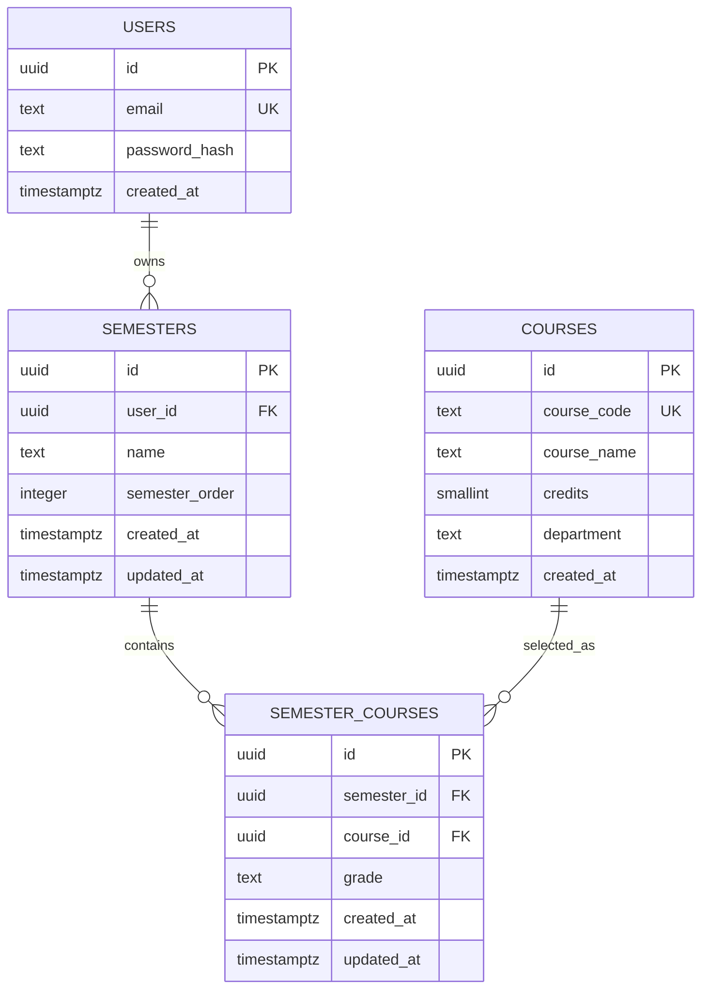

# CGPA Pilot BPGC

[](https://github.com/saatvikn/cgpa_pilot_bpgc/actions/workflows/ci.yml)
[](LICENSE)

A full-stack CGPA tracker for BITS Pilani, Goa Campus students. Build semesters, add courses from the campus catalogue, record grades, and see credit-weighted SGPA and CGPA values.

## Live deployment

- **Website:** [cgpa-pilot-bpgc.vercel.app](https://cgpa-pilot-bpgc.vercel.app/)
- **API:** [cgpa-pilot-bpgc-api.onrender.com](https://cgpa-pilot-bpgc-api.onrender.com/)
- **Health check:** [cgpa-pilot-bpgc-api.onrender.com/api/health](https://cgpa-pilot-bpgc-api.onrender.com/api/health)

## Features

- Register, log in, and log out with JWT authentication in an HTTP-only cookie.
- Create, edit, order, and delete semesters.
- Search a seeded catalogue of 601 BITS Goa courses by code or name.
- Add courses, select grades, and remove courses from a semester.
- Calculate SGPA and CGPA using course credits; ungraded courses are ignored.
- Keep every student's semester data isolated through server-side ownership checks.

## Stack

- **Frontend:** Next.js 16 and React 19
- **Backend:** Node.js and Express 5
- **Database:** PostgreSQL hosted on Supabase
- **Validation and security:** Zod, bcryptjs, JWT, Helmet, and rate limiting
- **Testing:** Node.js test runner and GitHub Actions

```text
Browser -> Next.js client -> Express API -> Supabase PostgreSQL
```

In production, the Next.js app proxies `/api` requests to the Express server so the authentication cookie stays first-party. See [ARCHITECTURE.md](ARCHITECTURE.md) for the folder map.

## Run locally

Requirements: Node.js 24, npm, and a PostgreSQL database.

```bash
git clone https://github.com/saatvikn/cgpa_pilot_bpgc.git
cd cgpa_pilot_bpgc/client
npm install
cd ../server
npm install
```

Copy `client/.env.example` to `client/.env.local` and `server/.env.example` to `server/.env`, then replace the placeholder values.

From `server/`, prepare the database:

```bash
npm run migrate -- 001_initial_schema.sql
npm run migrate -- 002_indexes.sql
npm run migrate -- 003_secure_public_tables.sql
npm run seed-courses
```

Start the two applications in separate terminals:

```bash
# server/
npm run dev
```

```bash
# client/
npm run dev
```

Open `http://localhost:3000`. The API runs at `http://localhost:5000`.

## Environment variables

| Application | Variable | Purpose |
| --- | --- | --- |
| Client | `NEXT_PUBLIC_API_URL` | Direct Express URL used locally |
| Client | `SERVER_API_URL` | Express URL used by the production Next.js proxy |
| Server | `PORT` | Express port; defaults to `5000` |
| Server | `CLIENT_URL` | Allowed frontend origin |
| Server | `DATABASE_URL` | PostgreSQL connection string |
| Server | `JWT_SECRET` | Secret used to sign tokens; use at least 32 random characters |
| Server | `NODE_ENV` | `development`, `test`, or `production` |

Never commit real `.env` files or credentials.

## API overview

All routes use the `/api` prefix. Protected routes authenticate through the HTTP-only `auth_token` cookie.

| Method | Route | Authentication | Purpose |
| --- | --- | --- | --- |
| `GET` | `/api/health` | No | Check whether the API is running |
| `POST` | `/api/auth/register` | No | Create an account and authentication cookie |
| `POST` | `/api/auth/login` | No | Log in and create an authentication cookie |
| `POST` | `/api/auth/logout` | No | Clear the authentication cookie |
| `GET` | `/api/auth/me` | Yes | Return the logged-in user |
| `GET` | `/api/courses?search=` | No | Search courses by code or name |
| `GET`, `POST` | `/api/semesters` | Yes | List or create semesters |
| `GET`, `PATCH`, `DELETE` | `/api/semesters/:id` | Yes | Read, edit, or delete a semester |
| `GET`, `POST` | `/api/semesters/:id/courses` | Yes | List or add courses in a semester |
| `PATCH`, `DELETE` | `/api/semester-courses/:semesterCourseId` | Yes | Update a grade or remove a selected course |

## Data and calculations

The database stores users, the shared course catalogue, user-owned semesters, and the courses and grades selected within each semester.

```text
SGPA or CGPA = sum(course credits × grade points) / sum(graded credits)
```

Supported grades are `A`, `A-`, `B`, `B-`, `C`, `C-`, `D`, and `E`.

## Checks

```bash
# server/
npm test

# client/
npm run lint
npm run build
```

## Deployment

The frontend is deployed on Vercel, the Express API runs on Render, and PostgreSQL is hosted by Supabase. Production requests travel through the Next.js `/api` proxy so authentication cookies remain first-party.

## What I learned

- How to design a relational, credit-weighted semester and course model with ownership checks.
- How to implement cookie-based JWT authentication securely across Next.js and Express.
- How to validate source data instead of confusing timetable credit hours with academic credits.
- How to deploy and connect a Vercel frontend, Render API, and Supabase database.

## Database schema



Each user can own multiple semesters. `semester_courses` joins a semester to the shared course catalogue and stores the selected grade. A course can appear only once in a semester, and a semester order can appear only once per user.

## Contributing

Contributions and bug reports are welcome.

1. Fork the repository and create a focused branch.
2. Install dependencies in both `client/` and `server/`.
3. Make the change and add small comments where they improve understanding.
4. Run the server tests, client lint, and client production build.
5. Open a pull request explaining the change and how it was tested.

Use short, natural commit messages that describe the result. Keep unrelated changes in separate commits.

## Security

Do not open a public issue for a vulnerability. Submit it privately through the repository's **Security** tab, or contact the maintainer through their GitHub profile if private reporting is unavailable.

Never commit passwords, database connection strings, JWT secrets, private keys, or real student data.

## License

Licensed under the [MIT License](LICENSE).
